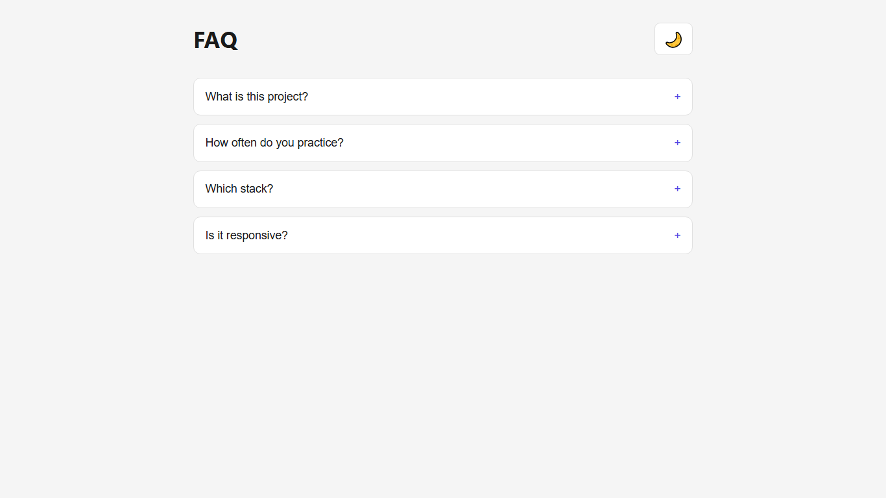
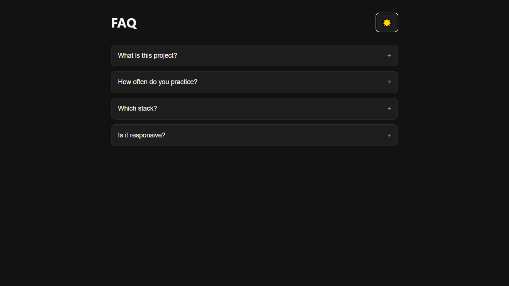

# Day 01 — FAQ Accordion + Dark Mode

## Requirements
- FAQ list with at least 4 questions
- Click question to open/close answer (accordion)
- Only one open at a time
- Dark/light toggle button
- Theme saved in localStorage

## Must use
- Semantic HTML
- CSS variables for colors
- Flex or Grid for layout
- Smooth transition on open/close
- Event delegation in JS

## Bonus
- Responsive on mobile
- Keyboard accessible (Enter/Space)

===================================================================

## Result Light Mode

## Result Dark Mode

